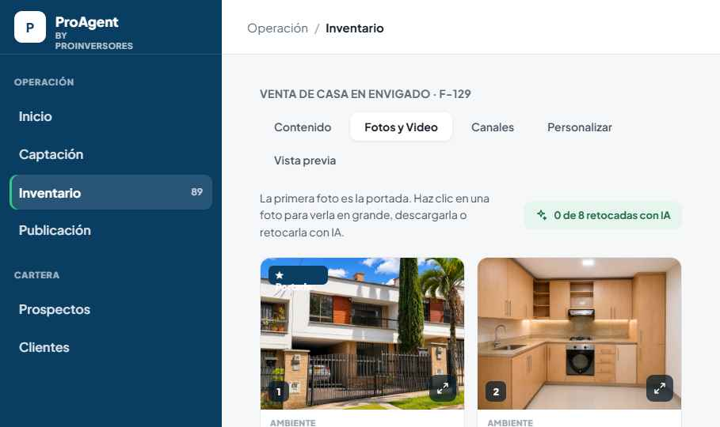
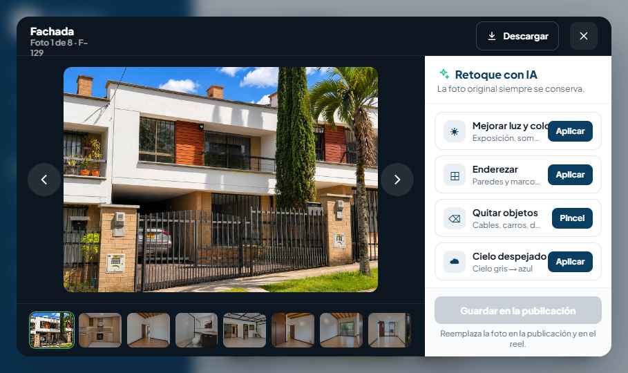
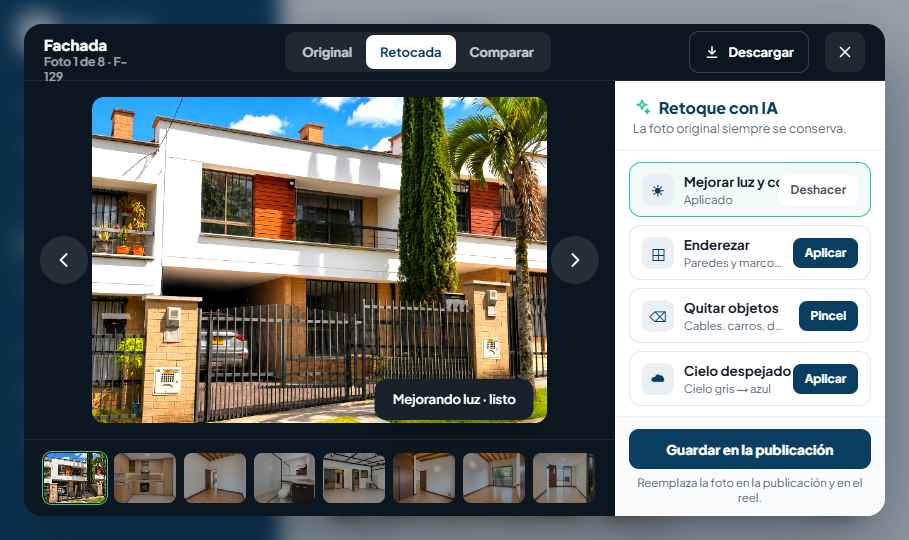
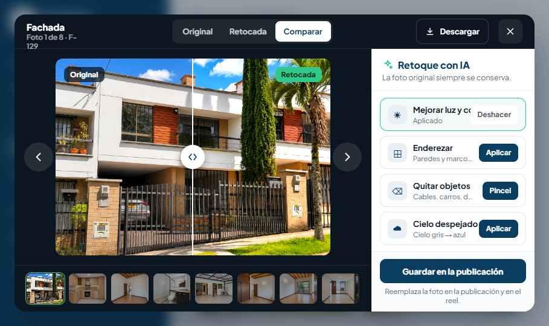
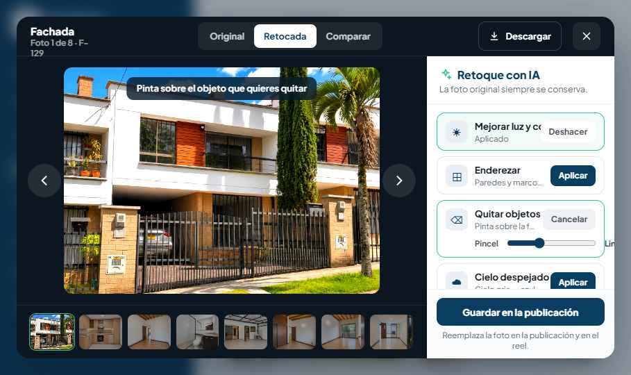

# Sprint 067 — Inventario › Visor y editor de fotos con IA

| Campo | Valor |
|-------|--------|
| **Estado** | `spec` — spec alineada con revisión staff + decisiones Owner (2026-11-11); aún **no** `ready_for_dev` hasta validación final del flujo reel/fotos |
| **Fecha spec** | 2026-11-11 (rev. 2) |
| **Épica** | E-INV-02 (media enriquecida del inventario) |
| **Repos** | `proagent-web` → `main` · `agente-inmobiliario` → `develop` |
| **Ruta web** | **`/properties/[id]`** — pestaña **Fotos y Video** (shell inventario actual; el handoff visual dice `/inventory` por legado de diseño) |
| **Handoff visual** | [`design_handoff_editor_fotos_ia/`](../design_handoff_editor_fotos_ia/) — **solo UX** (medidas, colores, flujo) |
| **Fuente de verdad** | **Este archivo** — API, modelo `fichas_fotos`, canales, cupo, deshacer |
| **Referencia interactiva** | [`Inventario - Editor de Fotos IA.dc.html`](../design_handoff_editor_fotos_ia/Inventario%20-%20Editor%20de%20Fotos%20IA.dc.html) |
| **Marca** | [`BRAND.md`](../BRAND.md) — tokens `--pa-*` |
| **Mobile** | **Fuera de alcance v1** — excepción explícita a paridad Web↔Mobile (Owner 2026-11-11) |

---

## Objetivo

En Inventario → **Fotos y Video**, permitir que el asesor:

1. Abra una foto en ventana flotante (overlay difuminado).
2. Navegue, descargue una foto o el zip existente.
3. Aplique **cuatro retoques con IA** (preview, comparar, deshacer por cadena, guardar).
4. Vea en grilla badge **✦ IA** y contador de fotos retocadas guardadas.

---

## Qué pasa al guardar (canales vs ficha) — Owner + staff

Hoy **todos** los consumidores leen el archivo referenciado en **`fichas_fotos.archivo`** bajo `FOTOS_DIR` (WASI, Instagram, Marketplace, reel, URLs `/fotos/...`, zip).

| Sistema | Tras **Guardar en la publicación** |
|---------|--------------------------------------|
| Grilla Inventario, vista previa web, **reel** (nueva generación / assets que lean `archivo`) | Usan el **archivo activo** retocado |
| **Canales ya publicados** (WASI, IG, MP, WhatsApp, etc.) | **No** se actualizan solos — siguen la foto que tenían al publicar |
| Ficha nunca publicada en un canal | Sin aviso en ese canal |

**v1 obligatorio (T2):** en pestaña **Canales**, un aviso **por cada canal donde la ficha ya está publicada** (reel incluido si aplica): *hay fotos actualizadas — republicar para reflejarlas*. Canales sin publicación previa: sin banner.

**No hay** re-publicación automática en v1.

El archivo en **`archivo_original`** (ver modelo) **nunca** se sobrescribe; solo cambia **`archivo`** al guardar.

---

## Evidencia visual (handoff)

> La maqueta HTML puede mostrar **Deshacer** en cada tarjeta “Aplicado”; en **producción** solo el **último** paso de la cadena es deshacible (ver § Deshacer).

### 01 — Grilla Fotos y Video



### 02 — Editor abierto



### 03 — Luz aplicada



### 04 — Comparar



### 05 — Pincel quitar objetos



Medidas, teclado, responsive: [`editor-fotos-ia-README.md`](../design_handoff_editor_fotos_ia/editor-fotos-ia-README.md) §1–10 (**no** §11–§15).

---

## Alcance v1

| Área | Entrega |
|------|---------|
| Grilla + modal | Según handoff visual + AC abajo |
| Backend | Migración, `PhotoEditProvider` **stub** hasta contratar proveedor real |
| Cupo | 50 retoques/día por **`owner_agente_id` de la ficha** (intentos fallidos cuentan) |
| Canales | Solo avisos de republicación; sin push automático |

### Fuera de v1

- Amoblado virtual, pisos/paredes, generación desde cero, retoque en lote.
- Re-publicación automática en canales.
- **App Expo** (editor móvil).
- Recorte/rotación manual no-IA.

---

## Decisiones cerradas (Owner 2026-11-11)

| # | Tema | Decisión |
|---|------|----------|
| 1 | Republicación | Guardar **no** republica; aviso por canal publicado (+ reel) |
| 2 | Cielo despejado | Botón **siempre habilitado** (no bloquear por `room_label`); si el proveedor no detecta cielo → error claro, foto intacta |
| 3 | Deshacer | Cada clic elimina el **último paso** de la cadena (LIFO); varios clics = varios pasos atrás |
| 4 | Cupo | 50/día del **dueño de la ficha**; admin retocando ficha ajena gasta cupo del dueño; **fallos cuentan** |
| 5 | Paridad mobile | **No** en v1 |
| 6 | Proveedor | v1 = **`PhotoEditProvider` simulador**; swap cuando Owner contrate servicio |
| 7 | Contador IA `n=0` | Ocultar chip |
| 8 | Descargar en Comparar | Versión **retocada** |
| 9 | Cerrar con borrador | Confirmar |
| 10 | Navegar mientras procesa | Sí + spinner en filmstrip |

---

## Modelo de datos (contrato T1)

### Tabla existente `fichas_fotos` (`agente-inmobiliario`)

```sql
-- Hoy: id, ficha_id, archivo, orden, room_label
-- Migración sprint:
ALTER TABLE fichas_fotos ADD COLUMN archivo_original TEXT;
-- Backfill: archivo_original = archivo donde NULL
```

| Columna | Rol |
|---------|-----|
| `archivo_original` | Path relativo en `FOTOS_DIR` del **upload inicial**; **inmutable** |
| `archivo` | Path del **activo servido**: publicadores, `/fotos/...`, reel, zip, grilla tras **guardar** |
| `ia_retoque_guardado` | `BOOLEAN` (o derivable) — badge ✦ cuando hubo save con IA |

**Borrador:** pasos y preview viven en tablas auxiliares; **`archivo` no cambia** hasta `POST .../save`.

### Tablas nuevas

```text
ficha_foto_edit_versions
  id, ficha_foto_id (FK fichas_fotos.id), status (draft|saved|discarded)
  created_by_agente_id, created_at, saved_at

ficha_foto_edit_steps
  id, version_id, op, mask_path?, result_path, provider, duration_ms, status, created_at
```

Cadena ordenada por `created_at`; deshacer = borrar último step y recalcular preview / `result_path` final del borrador.

---

## API (`/api/web`, E-INV-01) — único contrato HTTP

`fotoId` = entero `fichas_fotos.id`.

| Método | Ruta | Descripción |
|--------|------|-------------|
| `POST` | `/api/web/properties/{fichaId}/photos/{fotoId}/edits` | `{ op, mask? }` multipart → `{ versionId, stepId, status: processing }` |
| `GET` | `/api/web/properties/{fichaId}/photos/{fotoId}/edits/{stepId}` | Poll → `{ status, previewUrl? }` |
| `DELETE` | `/api/web/properties/{fichaId}/photos/{fotoId}/versions/{versionId}/steps/last` | Deshacer último paso |
| `POST` | `/api/web/properties/{fichaId}/photos/{fotoId}/versions/{versionId}/save` | Copia resultado a nuevo archivo, actualiza `archivo`, set `ia_retoque_guardado`; devuelve flags de aviso canal |
| `DELETE` | `/api/web/properties/{fichaId}/photos/{fotoId}/versions/{versionId}` | Descarta borrador |
| `GET` | `/api/web/properties/{fichaId}/photos/{fotoId}/download?version=original\|active` | Redirect; original → `archivo_original`, active → `archivo` |

**Cupo:** middleware/chequeo por `owner_agente_id` de la ficha antes de encolar step.

**Auth:** E-INV-01; cupo siempre del dueño de la ficha.

---

## UX: Deshacer (desvío de la maqueta)

- Tarjetas con ops ya aplicadas muestran subtítulo **"Aplicado"** sin botón Deshacer individual.
- **Un solo** control **Deshacer** (o botón activo solo en la tarjeta del **último** `op` de la cadena) llama `DELETE .../steps/last`.
- Si la maqueta HTML muestra Deshacer en “luz” y “enderezar” a la vez, **producción sigue esta spec**.

---

## Tickets

### T1 — Backend (`develop`)

- Migración `archivo_original` + tablas versiones/steps.
- `PhotoEditProviderStub` (delays + archivos dummy o filtros locales mínimos).
- Cola async in-process, timeout 60s.
- En `save`: escribir nuevo JPEG en `FOTOS_DIR`, actualizar `fichas_fotos.archivo`.
- Endpoint o campo en GET ficha: `canales_con_fotos_desactualizadas[]` para banners T2.

**AC T1**

- [ ] `archivo_original` intacto; `archivo` apunta al activo tras save.
- [ ] WASI/IG/MP **sin cambio** hasta republicar manual (test: archivo en disco no cambia para listing remoto existente).
- [ ] Cadena acumulativa; `DELETE steps/last` LIFO.
- [ ] `sky_replace`: siempre invocable; error si no hay cielo (stub puede simular).
- [ ] Cupo por dueño de ficha; fallo consume cupo.
- [ ] 403/404 E-INV-01.

### T2 — Web (`main`)

- Ruta **`/properties/[id]`** pestaña fotos (no inventar `/inventory`).
- `PhotoEditorModal` + HTTP solo rutas § API.
- Banners Canales según respuesta backend.
- Deshacer según § UX Deshacer.

**AC T2:** AC producto § + typecheck/build.

### T3 — Smoke Owner

- Guardar retoque → grilla/reel preview usan nueva foto → canal publicado sigue viejo hasta republicar → banner visible.

---

## Criterios de aceptación (producto)

- [ ] **AC-01** Clic en imagen abre editor; controles de grilla con `stopPropagation`.
- [ ] **AC-02** Ampliar + badge ✦ en fotos con save IA.
- [ ] **AC-03** Modal: blur, cierre con confirmación si borrador.
- [ ] **AC-04** Navegación circular + filmstrip.
- [ ] **AC-05** Descargar versión visible; nombre `{código}-{n}-{ambiente}{-ia}.jpg`.
- [ ] **AC-06** Panel sin scroll en 820px.
- [ ] **AC-07** Estado procesando + toast "· listo".
- [ ] **AC-08** Deshacer solo último paso de cadena (un control; no por herramienta histórica).
- [ ] **AC-09** Pincel: máscara, Limpiar, Quitar.
- [ ] **AC-10** Cielo: **habilitado** siempre; error si no hay cielo; cupo gastado en fallo.
- [ ] **AC-11** Segmented + comparar con accesibilidad.
- [ ] **AC-12** Guardar actualiza grilla/reel activo vía `archivo`; **no** actualiza listings remotos.
- [ ] **AC-13** Original vía `archivo_original` visible/descargable.
- [ ] **AC-14** Focus trap.
- [ ] **AC-15** Error + Reintentar.
- [ ] **AC-16** Aviso republicación **por canal publicado** (y reel si aplica); silencio en canales nunca publicados.

---

## Checklist antes de `ready_for_dev`

- [x] Contrato `fichas_fotos.archivo` / `archivo_original` (staff).
- [x] Decisiones Owner en spec.
- [x] README marcado handoff visual.
- [ ] Owner smoke del flujo reel/fotos actual.
- [ ] Cambiar `SPRINT.md` a `ready_for_dev` cuando apruebe.

---

## Referencias

| Recurso | Path |
|---------|------|
| Handoff visual | `design_handoff_editor_fotos_ia/editor-fotos-ia-README.md` |
| HTML | `design_handoff_editor_fotos_ia/Inventario - Editor de Fotos IA.dc.html` |
| Backend fotos | `agente-inmobiliario` `database.py` (`fichas_fotos`), `ficha_fotos.py`, `web/router.py` |
